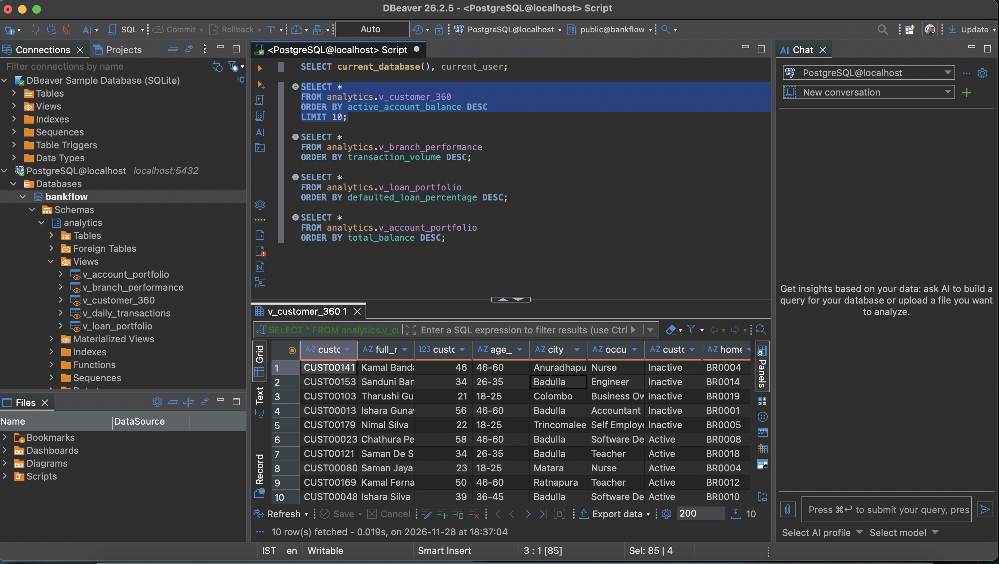
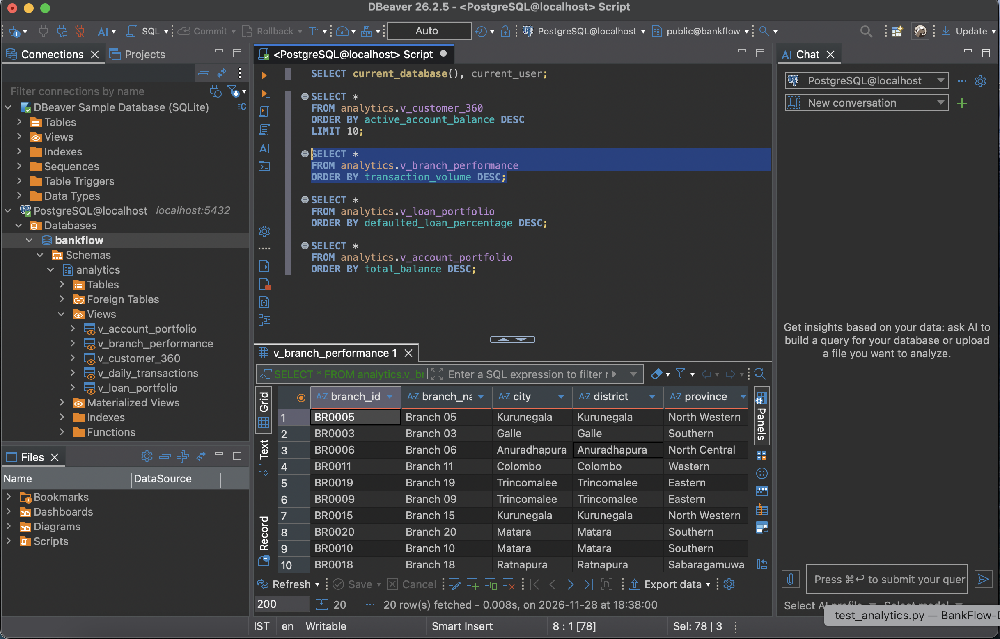
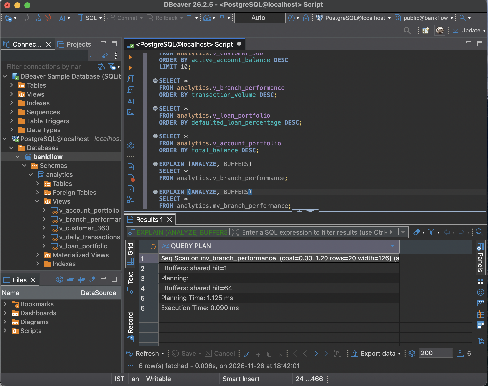

# BankFlow-Data-Engineering-Pipeline-Copy
End-to-end banking data engineering pipeline using Python, Pandas, PostgreSQL, Apache Airflow, PySpark and Docker.

## Project Progress

### Day 01 – Project Setup

- GitHub repository initialization
- Python virtual environment configuration
- Project directory structure
- Dependency management
- Environment configuration

### Day 02 – Data Generation and Bronze Ingestion

- Generated six synthetic banking datasets containing 15,720 records.
- Implemented a Python-based batch ingestion pipeline.
- Implemented timestamp-based Bronze storage.
- Added source schema validation and ingestion metadata.
- Implemented SHA-256 file integrity verification.
- Implemented primary key, foreign key and financial business rule validation.
- Added failure handling for incomplete ingestion batches.

### Pipeline Architecture

Source CSV Files → Batch Ingestion → Bronze Layer → Data Quality Validation → Silver Layer (planned) → Gold Layer (planned)

### Technologies

Python, Pandas, JSON, CSV, SHA-256, Git and GitHub.

### Data Privacy

All banking data used in this project is synthetically generated. The project does not use real customer records or confidential banking information.

### Day 03 – Data Cleaning and Silver Transformations

- Implemented automated Bronze data profiling.
- Developed reusable data cleaning and standardization functions.
- Implemented banking-specific data transformations.
- Added customer segmentation and account balance categorization.
- Implemented signed and realized transaction amount calculations.
- Added loan maturity date and payment transformations.
- Converted cleaned CSV datasets into Apache Parquet format.
- Implemented invalid record quarantine and record reconciliation.
- Added Silver layer metadata and data lineage tracking.
- Implemented Silver data quality validation.
- Developed automated unit tests using Pytest.

**Technologies:** Python, Pandas, NumPy, PyArrow, Apache Parquet, JSON and Pytest.

**Architecture:**

Source Data → Bronze Ingestion → Data Profiling → Silver Transformations → Silver Validation → Gold Analytics (Planned)

### Day 04 – PostgreSQL Database Integration

- Configured a local PostgreSQL database for banking data storage.
- Designed a relational database schema containing six banking entities.
- Implemented primary keys, foreign keys and database constraints.
- Created indexes for commonly queried columns.
- Implemented secure database configuration using environment variables.
- Developed Python database connectivity using SQLAlchemy and Psycopg.
- Implemented automated Silver Parquet-to-PostgreSQL loading.
- Added transactional full-refresh processing and rollback handling.
- Implemented exact decimal storage for financial amounts.
- Added database-level data lineage and load history tracking.
- Implemented automated database validation and integration testing.

**Technologies:** PostgreSQL, SQL, Python, Pandas, SQLAlchemy, Psycopg, PyArrow, DBeaver and Pytest.

**Pipeline Architecture:**

Source CSV → Bronze Ingestion → Silver Transformation → PostgreSQL Loading → Database Validation → Gold Analytics (Planned)

## Day 5 – Advanced SQL & Analytical Processing

Implemented a PostgreSQL analytical processing layer on top of validated Silver banking datasets.

### Features

- Advanced SQL joins, CTEs, and correlated subqueries
- Window functions and time-series analysis
- Customer 360 analytical dataset
- Branch performance analysis
- Daily transaction aggregation
- Loan and account portfolio analysis
- Reusable analytical views
- Materialized views and stored procedures
- Automated materialized view refresh
- Partial and composite indexes
- SQL query execution plan analysis
- Analytical data quality validation
- Parameterized integration testing

### Analytics Architecture

Silver Parquet → PostgreSQL Silver Schema → Analytical Views → Materialized Views → Future Gold Layer

### Analytical Database Objects

- 5 analytical views
- 2 materialized views
- 1 refresh stored procedure
- 15 analytical validation rules
- 18 analytics integration test cases

### Running the Analytics Layer

```bash
python -m src.database.init_analytics
python -m src.database.refresh_analytics
python -m src.validation.validate_analytics
python -m pytest tests/test_analytics.py -v
```

Detailed implementation documentation: [Day 5 – Advanced SQL](docs/day05_advanced_sql.md)

### Analytics Implementation Screenshots

#### PostgreSQL Database Structure


#### Customer 360 Analysis


#### Branch Performance Analysis


#### SQL Query Optimization


## Day 6 – Data Warehousing & Dimensional Modelling

Implemented a dimensional banking data warehouse using PostgreSQL, SQL, Python and SQLAlchemy.

### Warehouse Features

- Star schema and fact constellation architecture
- Fact and dimension tables
- Surrogate and natural keys
- Automatically generated date dimension
- Conformed dimensions
- SCD Type 1 dimension management
- SQL-based ELT transformations
- Transactional fact loading
- Financial reconciliation
- Data lineage and warehouse load history
- Automated warehouse validation and testing

### Warehouse Components

| Component | Count |
|---|---:|
| Dimension tables | 5 |
| Fact tables | 4 |
| Load history tables | 1 |
| Warehouse validation rules | 20 |
| Warehouse integration tests | 27 |

### Running the Warehouse Pipeline

```bash
python -m src.warehouse.init_warehouse
python -m src.warehouse.load_warehouse
python -m src.validation.validate_warehouse
python -m pytest tests/test_warehouse.py -v
```

### Warehouse Architecture

Bronze CSV → Silver Parquet → PostgreSQL Silver → Dimensional Warehouse → Gold Layer

### Data Warehouse Evidence


Detailed documentation: [Day 6 – Data Warehousing](docs/day06_data_warehouse.md)